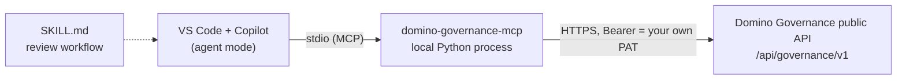
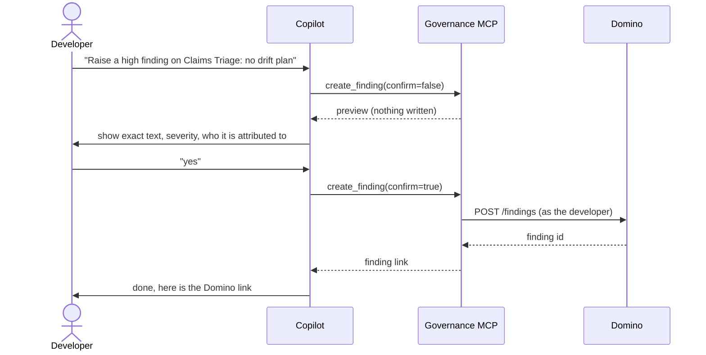

# Domino Governance MCP for GitHub Copilot

See and act on **Domino Governance** from inside GitHub Copilot Chat (agent mode) in VS Code:
ask what is waiting on you, read a bundle and open its attachments, raise a finding, record an
approval. Domino stays the system of record; every write is made as **you**, shown to you first,
and confirmed by you.

## How it fits together



### Raising a finding



## Tools

| Tool | Type | What it does |
|---|---|---|
| `whoami` | read | Who and which host you are acting as. Call first. |
| `list_my_governance_items` | read | Bundles with a stage assigned to you or an approval in review waiting on you (including via your orgs). |
| `get_bundle` | read | Stage, approvals, open findings, attachments with direct links, audit-trail link. |
| `list_findings` | read | All findings on a bundle. |
| `create_finding` | write | Raise a finding. Preview first; needs `confirm=true`. |
| `submit_approval` | write | `approve`, `conditional_approve` or `request_changes`. Preview first; needs `confirm=true`. |

Without `confirm=true` a write tool returns a preview and changes nothing. Every finding written
ends with ` [submitted via GitHub Copilot / Domino Governance MCP]`.

**Approval comments.** Domino's approval API records who decided and when, but has no comment
field. So an `approve` comment is not stored in Domino (the preview says so). For
`request_changes` and `conditional_approve` the comment is saved as a finding, so the reason is
visible in Domino.

To switch approvals off for a team, set `DOMINO_GOV_ALLOW_APPROVALS=false` (default is on).

## Setup (about 10 minutes)

**You need:** VS Code with GitHub Copilot and MCP in agent mode (use a recent release; MCP servers
need to be allowed by your GitHub org policy on Copilot Business/Enterprise), Python 3.10+ and
[`uv`](https://docs.astral.sh/uv/) or `pipx`.

1. **Create a Personal Access Token in Domino.** Account > Account settings > Personal Access Token >
   *Generate new Token*. Copy it now; it is shown once. Legacy API keys do **not** work.
2. **Install the server** (pick one):
   - `pipx install git+https://github.com/ddl-nick-goble/copilot-governance`, or
   - nothing: use `uvx` in step 3.
3. **Add `.vscode/mcp.json`** to your workspace (copy `.vscode/mcp.json.example`). Set your Domino
   URL. VS Code asks for the token on first start, so it never sits in a file.
   Zero-install variant:
   ```json
   "command": "uvx",
   "args": ["--from", "git+https://github.com/ddl-nick-goble/copilot-governance", "domino-governance-mcp"]
   ```
4. **Start the server**: open `mcp.json` and click *Start* above the server, or run
   *MCP: List Servers*. Enter your token when prompted.
5. **Use it**: open Copilot Chat, switch to **Agent** mode, check `domino-governance` is listed under
   *Tools*, and ask: *"What's waiting on me in Domino governance?"*
6. **Add the skill** (recommended): copy `.github/skills/domino-governance-review/` into your repo.
   It teaches Copilot the review flow (summarise, preview, ask, confirm, link back).

| Env var | Required | Meaning |
|---|---|---|
| `DOMINO_HOST` | yes | Your Domino URL, e.g. `https://se-demo.domino.tech` |
| `DOMINO_API_KEY` | yes | Personal Access Token (sent as `Authorization: Bearer`) |
| `DOMINO_GOV_ALLOW_APPROVALS` | no | `false` disables `submit_approval` (default `true`) |

Inside a Domino workspace no token is needed: the server uses the workspace credential
(`DOMINO_API_HOST` and the local token endpoint).

## Troubleshooting

| Symptom | Fix |
|---|---|
| Tool returns `No Domino credential found` | Set `DOMINO_API_KEY` and `DOMINO_HOST` in `mcp.json`. |
| `Domino rejected DOMINO_API_KEY (401/403)` | Use a Personal Access Token, not a legacy API key; check it has not expired. PATs are revoked if an admin changes your roles. |
| Server missing from Tools | Agent mode only. Check *MCP: List Servers*; ask your admin whether the org's Copilot policy allows MCP servers. |
| Command not found | Use the `uvx` variant, or run `pipx ensurepath` and restart VS Code. |
| Queue says nothing is waiting | An approval only counts once it is **submitted for review** and you are a listed approver (directly or via an org). |
| "not a listed approver" | Domino only accepts decisions from listed approvers. This server will not work around that. |
| Queue is slow (5-10 s) | It scans open approvals across all active bundles on large instances. |
| Links open the bundles list | The bundle's project was deleted, so Domino has no project page for it. |

## Development

```bash
pip install -e ".[dev]"
export DOMINO_HOST=https://your-domino   # plus DOMINO_API_KEY, or run inside a Domino workspace
python scripts/seed_demo.py              # creates the [DEMO] bundles in your own project
DOMINO_TEST_BUNDLE=<id> pytest           # drives every tool through a real MCP client
```

`tests/test_write_tools.py` needs a dedicated bundle on a policy where you are an approver (it
writes to it, then restores it). Endpoints used are in [`docs/api-map.md`](docs/api-map.md); the demo
run-of-show is in [`docs/demo-script.md`](docs/demo-script.md).
